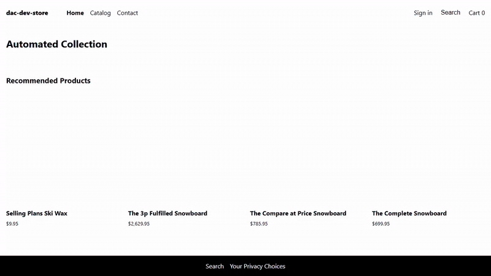

# hydrogen-storefront



*The storefront running locally against a Shopify development store: home, Catalog, a product page, the Color picker, Add to cart, and the cart drawer updating from "Cart 1" to "Cart 2". Checkout is not part of the recording.*

A headless Shopify storefront on [Hydrogen](https://shopify.dev/custom-storefronts/hydrogen) (React Router, Vite), connected to a Shopify **development store** (`dac-dev-store`) through the Storefront API.

**What this is, plainly:** Shopify's own Hydrogen "Skeleton" starter with the store connection done. The pages and components are the stock template (home, collections, product pages, search, cart, blogs, policy pages, customer account), not a custom design. The work in this repo is the wiring: a development store, a Storefront access token, the environment settings, and live queries against the store that return its products. The products are Shopify's sample snowboards and ski wax, not a real catalogue, and the recording stops at the cart. It is not deployed anywhere; the GIF above is a recording of the local run.

## Run it

Requirements: Node.js 22 or 24 and your own Shopify development store.

```bash
npm install
cp .env.example .env     # fill in the store domain, the Storefront token and a session secret
npm run dev              # Shopify CLI starts the storefront and prints its local URL (port 3000 by default)
```

`npm run dev` needs no Shopify CLI login; it runs the app locally and reads the store through the token in `.env`. Add `-- --port 4410` to pick another port.

`.env.example` explains the one non-obvious step: the Storefront token is minted through the Admin API with `storefrontAccessTokenCreate`, which is denied unless the app already holds the `unauthenticated_*` scopes, and the denial does not say so. `PUBLIC_CHECKOUT_DOMAIN` is also required, because the analytics provider throws on every render without it.

## What the running storefront shows

Header links: Home, Catalog, Contact, Sign in, Search, Cart. The home page lists "Recommended Products" from the store's "Automated Collection", the Catalog lists the store's products, a product page has a Color picker and an "Add to cart" button that opens a cart drawer with quantity controls, discount and gift card fields and "Continue to Checkout", and Search returns matching products. The layout holds at a 390 px phone width.

## Stack

React Router, Hydrogen, Vite, the Shopify CLI, the Storefront API (version set in `.env`), GraphQL code generation, ESLint and Prettier.

## Limits

- The UI is the starter's, unmodified; the store is a development store with sample products.
- No tests beyond the starter's lint setup, and no hosted copy.
